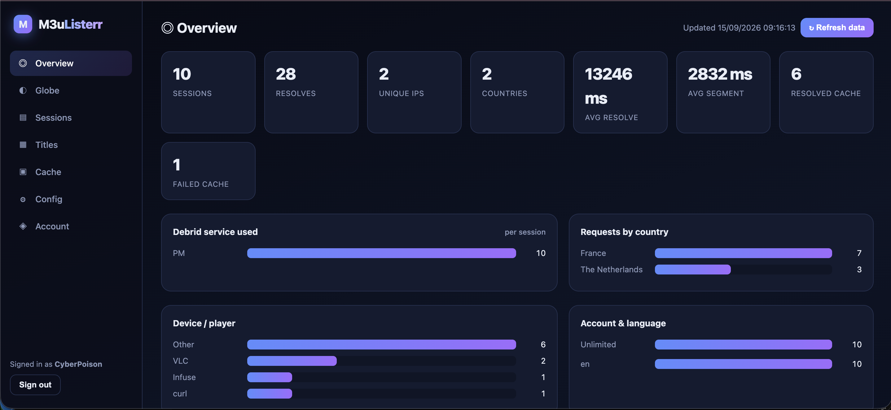
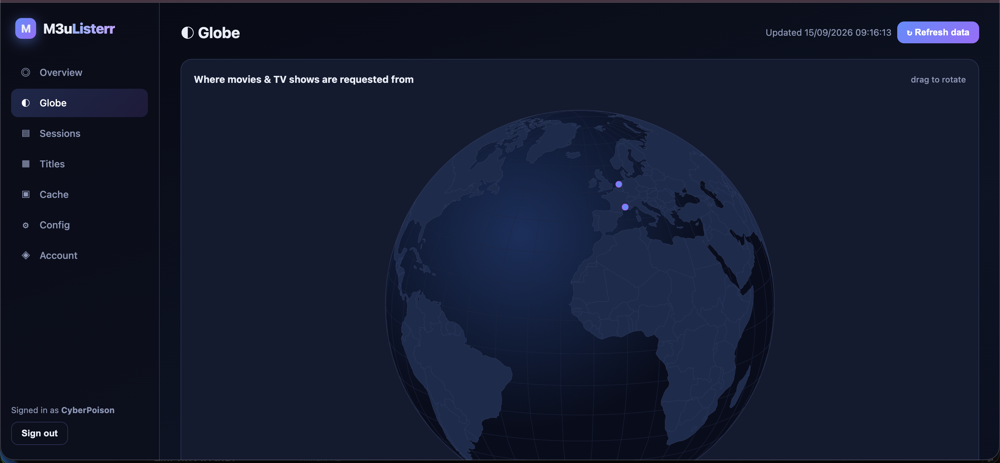
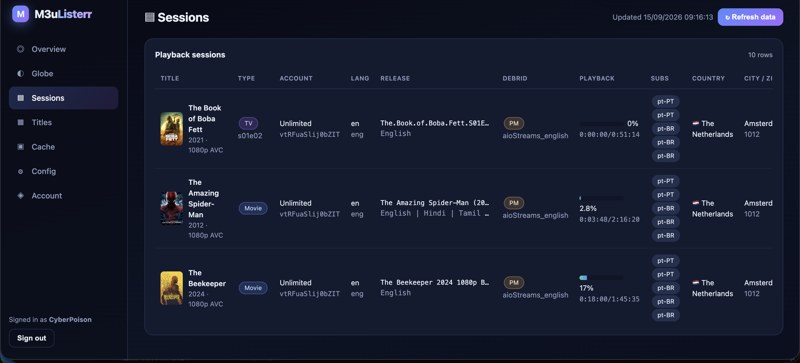
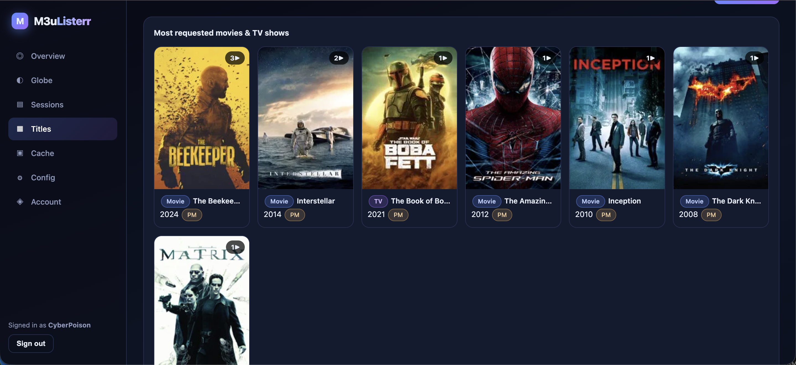

# 🍿 TMDB to VOD: Free Live TV, Movies & Series Playlist [Xtream Codes & M3U8]

[Français](README_FR.md) | [Português](README_PT.md) | [Italiano](README_IT.md) | [Ελληνικά](README_EL.md) | [العربية](README_AR.md) | [עברית](README_HE.md) | [Deutsch](README_DE.md)

[](https://github.com/CyberPoison/m3ulisterr/actions/workflows/ci.yml)
[](https://ghcr.io/cyberpoison/m3ulisterr:latest)

---

# 📝 Summary

<p>Create Live TV, Movies and TV Series Video on Demand (VOD) Playlists using Xtream Codes or M3U8 Format.</p>

<p>Generate dynamic playlists for Live TV, Movies, and TV Series using a mock version of Xtream Codes. Create IPTV, Movies, and Series playlists with comprehensive metadata. Streaming links are located using TMDB, Real-Debrid, Premiumize, and Direct Sources. Ideal for use with apps like iMplayer, Tivimate, IPTV Streamers Pro, XCIPTV Player, and more.</p>

<table style="border-collapse: collapse; border: none;">
  <tr>
    <td style="border: none;">
      <a href="https://github.com/CyberPoison/m3ulisterr/archive/refs/tags/latest.zip">
        
      </a>
    </td>
    <td style="border: none; padding-left: 10px;">
      <a href="https://ko-fi.com/gogetta69">
        
      </a>
    </td>
  </tr>
</table>

---

# 🎬 Demo Video


<br><br>

---

# 📸 Screenshots

<table>
  <tr>
    <td align="center">
      
    </td>
    <td align="center">
      
    </td>
    <td align="center">
      
    </td>
  </tr>
  <tr>
    <td align="center">
      
    </td>
    <td align="center">
      
    </td>
    <td align="center">
      
    </td>
  </tr>
  <tr>
    <td align="center">
      
    </td>
    <td align="center">
      
    </td>
    <td align="center">
      
    </td>
  </tr>
  <tr>
    <td align="center">
      
    </td>
  </tr>
</table>

---

# ✨ Features

- **Dynamic playlist generation** for Live TV, Movies, and TV Series.
- **Seamless Integration** with TMDB, Real Debrid, Premiumize, and direct sources for enhanced content retrieval.
- **Xtream Codes Emulation** providing full metadata details.
- **Included Live TV Sources**: [Daddylive](https://href.li/?https://dlhd.so/24-7-channels.php), [TheTVApp](https://href.li/?https://thetvapp.to/), [MoveOnJoy](https://i.imgur.com/dFazdys.png), [Streamed Su Sports](https://href.li/?https://streamed.pk/), [Pluto TV](https://href.li/?https://downloads.pluto.tv/docs/pluto_tv_channels_listing.pdf), and more.
- **EPG Integration**: Most live TV channels include detailed TV Guide (EPG) information.
- **Automatic Caching** of found streaming links for efficient, buffer-free playback.
- **Adult VOD Integration**: 10K full-length adult movies added to the VOD (disabled by default).
- **Correct-Language Audio Selection** for multi-audio releases (reads the file header, not just the tag).
- **Dedicated French Path** (`UnlimitedFR` / `?lang=fr`) with header-verified French audio and a cached-first quality ladder.
- **Robust Subtitles**: European (pt-PT) and Brazilian (pt-BR) Portuguese subtitle tracks, with a direct OpenSubtitles API fallback.
- **M3uListerr Analytics Dashboard**: Rich playback stats, an interactive globe, charts, and a per-session table (see details below).
- **Weighted AllDebrid/Premiumize preference** (`$aioDebridWeights`): configurable % split that biases the AIOStreams resolver toward a preferred debrid service to protect quota; a weight of 0 is a hard exclusion.
- **Saga/pack mismatch guard**: AIOStreams multi-film pack candidates are rejected when their filename confirms a different release year than the title requested.
- **Prewarm `--expiring` mode**: the cron prewarmer re-warms durable-cache entries before they expire, using the original account and language per entry — no static list needed.
- **IP whitelist + loopback self-protection**: the server's own loopback (`127.0.0.1`) is unconditionally trusted, preventing the prewarm cron from rate-limiting itself.
- **Block/limit notice as real MPEG-TS video**: the "blocked" or "not available" screen is delivered as a live H.264/AAC transport stream, so every IPTV player (IMPlayer, MyTVOnline3, STBEMU, ...) decodes it correctly.

---

# 🚀 Getting Started

[](https://rumble.com/embed/v54v3nx/?pub=4)

1. **Configuration**: Start by setting up the script with the required free [TMDB API Key](https://developer.themoviedb.org/docs/getting-started) and an optional private key for [Real Debrid](https://real-debrid.com/apitoken) or [Premiumize](https://www.premiumize.me/account), which are not mandatory.

2. **Xtream Codes Integration**: Enter the IP address or domain as an Xtream Codes server. Any username and password will work since the script doesn't require authentication. This will automatically load the Live TV, Movies, and TV Series playlists into your app.

3. **Non-Xtream Codes Apps**: If your app does not support Xtream Codes, load `http://IP_ADDRESS/player_api.php?action=get_vod_streams` (replace `IP_ADDRESS` with your server's IP address) in your browser. Then locate the `playlist.m3u8` in the same folder as the script and load it as an M3U playlist. Note that M3U8 playlists are available for movies and live TV only; TV series cannot be loaded as an M3U playlist.

4. **Playback**: Once everything is set up and the playlists are loaded, you should be able to play a video. Clicking the play button will trigger the script to search multiple websites in the background for a playable link. Please be patient and allow some time for a link to be found and streaming to commence. The script caches and stores the found link for approximately 3 hours, aligning with the typical access token expiration of most direct sources (around 4 hours).

5. **Local Hosting**: If you lack a remote server to run this extremely lightweight script, you can easily install and run it on your desktop computer using software like XAMPP or Docker.

---

# 🤖 What is HeadlessVidX?

HeadlessVidX is a powerful tool designed to simplify the development of video extractors for streaming websites. It provides an easy-to-use solution for users, regardless of their programming skills, to quickly add video streaming sites to tools such as 'TMDB TO VOD'.

<table>
  <tr>
    <td align="center">
      
    </td>
    <td align="center">
         
    </td>
  </tr>
</table>

---

# 📋 Creating Playlist

You no longer need to manually run `create_playlist.php` and `create_tv_playlist.php`. With the workflow set up on GitHub, these playlists are automatically generated twice a day. To create your own customized movies and series playlist locally, simply set `$userCreatePlaylist = true;` in the `config.php` file.

https://github.com/user-attachments/assets/c6af6149-c170-45fc-a6ac-32edd1b3405b

---

# 🐳 Docker Deployment

You can seamlessly run the entire stack using Docker and Docker Compose.

### ⚡ Quick Start (No git clone needed)

If you just want to run the application immediately using the public image, run the following commands:

```bash
mkdir -p m3ulisterr_data
touch config.php
# 1. Create a custom Docker network for DNS resolution
docker network create m3ulisterr_net

# 2. Start the Gluetun VPN container to bypass Debrid IP blocks
# (See [Gluetun VPN](https://github.com/qdm12/gluetun) for provider configurations)
docker run -d \
  --name gluetun \
  --network=m3ulisterr_net \
  --cap-add=NET_ADMIN \
  --device=/dev/net/tun:/dev/net/tun \
  -e VPN_SERVICE_PROVIDER=custom \
  qmcgaw/gluetun

# 3. Start m3ulisterr routed through the Gluetun VPN network
docker run -d \
  --name m3ulisterr \
  --network=container:gluetun \
  -v $(pwd)/m3ulisterr_data:/var/www/html/m3ulisterr_data \
  -v $(pwd)/config.php:/var/www/html/config.php \
  -e HEADLESSVIDX_ADDRESS=localhost:3202 \
  ghcr.io/cyberpoison/m3ulisterr:latest

# 4. Start a lightweight proxy to fix VPN asymmetric routing for incoming access
# (We fetch the VPN's internal IP directly to avoid any Docker DNS resolution bugs on your host)
GLUETUN_IP=$(docker inspect -f '{{range.NetworkSettings.Networks}}{{.IPAddress}}{{end}}' gluetun)
docker run -d \
  --name m3ulisterr-proxy \
  --network=m3ulisterr_net \
  -p 8080:80 \
  caddy:alpine caddy reverse-proxy --from :80 --to $GLUETUN_IP:80
```
*Note: Make sure to edit the `config.php` file later with your API keys and restart the container!*

### 🛠️ Using Docker Compose
**Prerequisites**: Docker and Docker Compose installed.

1. Clone the repository.
2. Configure your `config.php` (or use environment variables for some settings).
3. Run the following command in the root directory:
   ```bash
   docker-compose up -d
   ```
4. Access the website at `http://localhost:8080`.

### 🐙 GitHub Actions
The project includes a GitHub Actions workflow (`.github/workflows/deploy.yml`) that automatically builds and pushes the Docker image to GitHub Container Registry (GHCR) on every push to the `main` branch.

### ⚙️ Environment Variables
The following environment variables can be used to configure the container:
- `HEADLESSVIDX_ADDRESS`: The address of the HeadlessVidX service (default: `localhost:3202`). In docker-compose, this is typically set to `headlessvidx:3202`.

---

# 📊 M3uListerr Analytics Dashboard

`dashboard.php` is a self-contained, login-protected analytics and control panel for the server. It records one lightweight event per playback (resolve, playlist, segment, subtitle, and proxy events) to a private log, imports them into a local SQLite database, and renders them as a modern, insightful dashboard.

### 📈 Dashboard Screenshots

**1. Overview Dashboard**  
  
> *Monitor the high-level health of your VOD server. Track total sessions, resolve performance, unique viewers, and the breakdown of movies versus TV shows to understand overall user engagement.*

**2. Interactive Globe**  
  
> *Visualize your audience globally! This 3D interactive globe plots exactly where each movie or TV show request originates, giving you a clear geographical view of your user base.*

**3. Sessions Tracking**  
  
> *A granular, per-playback table offering a deep dive into individual streams. See exact releases, requested audio languages, debrid services used, playback progress (% and time), and detailed viewer metrics like ISP, device, and geolocation.*

**4. Top Titles Grid**  
  
> *A visually appealing poster grid showcasing the most requested movies and TV shows. Quickly identify what content is trending among your viewers.*

**5. Cache Logs Viewer**  
  
> *Inspect internal system behaviors with the cache viewer. It displays resolver `cache.json` entries, allowing you to debug and ensure your content delivery is operating flawlessly.*

### 🛡️ Security Features
- **Secure Credentials**: First run prompts you to create an admin account. Passwords are safely hashed (Argon2id) in a private SQLite database.
- **Isolated Data**: All state is kept in a private `m3ulisterr_data/` directory that the web server strictly refuses to serve to the public.
- **Hardened UI**: Features a strict Content-Security-Policy, CSRF tokens, session binding, timeouts, and login rate-limiting to protect the dashboard from abuse.
- **Geolocation Caching**: IP geolocation (country/city/ISP) uses ip-api.com, caching viewer IPs locally to prevent API limits.

### 🚦 Getting Started with the Dashboard
1. Deploy the files as usual (the dashboard needs no extra setup).
2. Ensure the app can create a writable `m3ulisterr_data/` directory next to the site (it is created automatically when writable).
3. Open `http://YOUR_SERVER/dashboard.php`, create the admin account, and sign in. Data is imported on the first load and whenever you press **Refresh data**.

---

# 🔄 Updates & Changelog

### 📅 Update 10/19/2026

**Fix: almost every adult film failed on production ("Tushy Raw V21" and ~99% of the catalog) - the source pages could not be fetched and nothing bounded the wait:**
- **Root cause (reproduced through the production byte proxy used as a relay):** the catalog source site (watchpornx.com, behind Cloudflare) answers the https page with an intermittent **525** (Cloudflare cannot finish TLS with its origin) to this server - "Failed to open URL" after ~11s - while the plain-http twin of the same page answered 200 in 0.9s. The adult resolver read the page with a bare `@file_get_contents()` (no timeout, no User-Agent), so a blocked page held the request for minutes (250s with an empty answer on production for Tushy Raw V21), and the addon fallback then could not help (that scene is only cached as a single non-cached file / per-performer multi-scene torrents).
- **Fix:** `adultFetchPage()` - short timeouts (4s connect / 9s total), a real browser User-Agent, gzip, optional `$HTTP_PROXY`, and `adultPageAttemptUrls()`: the url as given, then its **http://** twin, then the url once more. A 40s budget now bounds the whole source step, and MixDrop (the hoster that resolves from every IP) is tried first. New diagnosis switch: `&dev=true&skipsources=1` skips the catalog sources to exercise the addon path alone.
- **Verified locally:** Tushy Raw V21 resolves through MixDrop in 3s and ffprobe reads the whole film (177 min, H.264 720p); a random sample of 8 other adult titles: 7 play (1 hoster 403), including a case where the first https attempt failed and the http retry succeeded; 4 new unit checks (attempt list, 525 then success, bounded failure). After the deploy please test one adult film on production; if https AND http both keep failing from the production IP the only remaining lever is a working `$HTTP_PROXY` (+ `$USE_HTTP_PROXY = true`) in the host config.php (the 9http proxy in the local config fails TLS to this site).
- **IPv6 last attempt (harmless extra, not the cause):** `adultFetchPage()` ends with one attempt forced to IPv6 (fails at once when the container has none). `curl -4` from the production host also returns the page (HTTP 200), so the intermittent 525 seen from inside the PHP container is not an IPv4/IPv6 matter; the retries (https, http, https, IPv6) are what absorb it. To compare, run the same `curl` from inside `docker exec tmdb-vod-php`.
- **Account hygiene:** the Real-Debrid account holds thousands of items (a dry run counted 6000 = the 30-page listing cap, torrents + links), largely added by the AIOStreams link verification; "Debrid limit reached" slates on 10/19 point at the account's active-download limit. See the automatic cleanup below.

**New: automatic cleanup of a debrid account that reports being full (Real-Debrid, Premiumize, AllDebrid, TorBox):**
- **Behaviour (requested):** when a service's OWN answer says the account is full - the ElfHosted slate "Debrid limit reached", Real-Debrid `too_many_active_downloads`, Premiumize / AllDebrid / TorBox "limit reached / quota exceeded / too many active ..." - every torrent and every unrestricted link on THAT service is deleted (Real-Debrid torrents + downloads, Premiumize transfers + cloud items, AllDebrid magnets + saved links + history, TorBox torrents / web / usenet downloads). **It deletes everything on the account, not only what this project added.**
- **Wired at:** the AIOStreams link verification (`aioNoteLimitSlates()`), Real-Debrid `addMagnet`, Premiumize cache check / directdl answers, and `debridHttp()` (AllDebrid / TorBox). Never on a timeout, "not cached", an auth error or a plain rate limit (`debridLimitReachedText()` is deliberately narrow).
- **Safety design:** new self-contained `debrid_cleanup.php` (not in `config.php`). No shell and no background process: the server fires a `POST debrid_cleanup.php` at itself (400 ms, not waited for) authenticated with an HMAC of the service and a 10-minute window, keyed with a random secret in a 0600 temp file - a public caller without the token (or with another service's token, or with GET) gets 403 and nothing happens. 30-minute cooldown per service so a cleanup that does not fix the problem cannot loop, one run at a time, 1500 deletions per run throttled under each API's rate limit, every action logged to `debrid_cleanup.log` (no keys in it). Off switch: `$debridAutoCleanOnLimit = false` in config.php (optional; default on); `$debridCleanupCooldownMinutes` changes the cooldown.
- **Manual / dry run:** `php debrid_cleanup.php realdebrid --dry-run` lists what would be deleted and deletes nothing.
- **Verified:** `tests/debrid_cleanup_test.php` against a mock of the four APIs (never a real account): full-account vs not-full answers, token rules (other service / expired / garbage / GET -> 403 and nothing deleted), each service really emptied, dry run, per-run cap, the authenticated self-call end to end, cooldown, off switch, no-key; plus the AIOStreams slate trigger test. All suites pass.

**Speed: HLS playlists are 9x smaller (1.3 MB -> ~140 KB) - the per-segment lines no longer repeat the whole source url:**
- **Found by driving MyTVOnline3 on a SHIELD with adb:** the player's heap sat at 55/61 MB with constant garbage collection and Android reported the UI thread blocked ("unprocessed events") for a minute or more while the server had delivered the first segments in seconds. Every one of the ~1300 segment lines of the video playlist AND of each audio rendition carried the full urlencoded AIOStreams /playback/ url (~900 chars): 1.3 MB of text per playlist, three playlists per start. (Desktop VLC, same engine, starts the same film in ~13s.)
- **Fix:** segment and init lines now carry `vid=h<20 hex>` (`hlsVideoRef()` in `hls_shared.php`, ~105 bytes per line); the four segment/init scripts restore the real url with `hlsExpandVideoParam()` from a small temp-file mapping that is refreshed on every use. `video=<url>` is still accepted everywhere (master playlist, links handed out earlier). Locally: video playlist 136 KB, audio playlist 158 KB for 1265 segments, init and segments answer 200. 5 new unit checks.
- **Also found while testing (not code, no change):** on the evening of 10/19 the AIOStreams instance answered "Something went wrong" / 503 or "Debrid limit reached" / "Couldn't start this download" for several titles (Godzilla x Kong, Inception) while others (The Dark Knight) resolved fine - the debrid account's active-download limit. A resolve in that state correctly ends in the "NOT AVAILABLE YET" notice.

**Fix: playing a film whose HLS entry was cached forced a full re-resolve (30s+ spinner), and a transient AIOStreams failure produced "NOT AVAILABLE YET" for an hour (found by driving MyTVOnline3 on the SHIELD with adb after the deploy):**
- **Cache liveness check made live links look dead:** the check of a cached HLS source went through `video_proxy.php`, which starts a SECOND cold Real-Debrid resolve of the same link (~25s) and blew its 15s budget, so a perfectly good cached entry was condemned and the title was resolved again on every play (dashboard: `fresh` session, 2 segments after 30s). `aioCachedSourceStillAlive()` now does the resolver's own direct 2 KB ranged GET from the server (8s) and only calls a source dead on a definitive answer (ElfHosted slate redirect, 4xx, non-video body); a timeout or 5xx counts as alive. The Wrong-IP protection stays (dead source -> miss, and the HLS fallbacks never redirect to the raw link).
- **One bad moment no longer blocks a film for an hour:** a failed resolve (movies and series) is cached 3 minutes instead of 60, and a resolve that already spent 75s stops trying the remaining slow scrapers (they added ~2.5 minutes before ending in the same "not available" notice - 192s from OK to the notice in the SHIELD test).
- **Measured on production:** a cold catalog fetch for a never-requested title takes ~30s there (13s locally), then verification 3-4s and probes ~1s: ~35s cold resolve. Unit tests: live / slate / 404 / timeout / bounded / fresh-result cases; all suites pass.

**Hotfix: the HLS cache liveness check no longer applies to freshly resolved results (it made every fresh English resolve fall through to the torrent scrapers for one release):**
- The previous fix put the source-liveness check inside `checkLinkStatusCode()`, which the provider loop also runs on a just-resolved result. A transient HEAD 404 through `video_proxy.php` on a brand-new link (seen on production with Godzilla x Kong right after the resolver had verified it) rejected a good stream, the resolve then ran every torrent scraper (60s, empty HTTP 200) and the TV just kept loading. Found by watching the SHIELD with adb after the deploy.
- The check now lives in `checkCachedLinkStatus()` and is called only where a link is READ BACK from the cache (movies and series); `checkLinkStatusCode()` trusts the playlist endpoint again. New unit check: a fresh HLS result is accepted even if a HEAD on its source would fail.

**Fix: ElfHosted "Wrong IP" slate on the TV (MyTVOnline3, Godzilla x Kong) - a dead cached HLS source is no longer served, and the HLS fallback never exposes the raw IP-locked link:**
- **What happened (reproduced with adb on the SHIELD + production):** the cached entry for the film was an HLS playlist whose SOURCE link had expired (the server's own byte proxy answered 502 for it). `checkLinkStatusCode()` trusted every `subtitle_track_playlist.m3u8` cache entry without looking at the source, so it was served; the master playlist then could not probe the source and its fallback answered `302 Location: <raw aiostreams.elfhosted.com/playback/...>`. An AIOStreams `/playback/` link is locked to the IP that first requested it (the server), so the player calling it directly got the slate "Wrong IP - Expected IP 37.59.104.1 / Current IP <device>".
- **Fix 1:** a cached HLS entry is now liveness-checked through the server's own byte proxy (same IP as the lock); a dead source is a cache miss and the title is re-resolved on the spot instead of staying broken until the cache entry expires (up to 10h, pre-warmed entries included).
- **Fix 2:** `plainVideoFallbackUrl()` - the "HLS not possible" fallbacks of `subtitle_track_playlist.php` and `subtitle_video_playlist.php` now redirect to `video_proxy.php?url=...&auto=1` (the server streams the bytes, any client IP works) instead of the raw source URL.
- **Verified:** 5 new unit checks (live HLS entry served, dead one is a miss, entry without source trusted, raw url wrapped in the proxy, own endpoints left alone), all suites pass.

**Speed: fast start - cold resolves went from 46-57s to ~17s (English, HLS + subtitles kept) and ~22s (French, plain proxy kept):**
- **Where the time went (measured on production and on a SHIELD Android TV over adb: VLC took 51.6s to start a cold film, 46.1s of it in `play.php`):** ~13s of unavoidable AIOStreams catalog latency, then ~30s verifying 15 links in one rush (waiting for the slowest cold Real-Debrid link and its 25s retry window, and tripping ElfHosted per-IP throttling), plus an ffprobe of EVERY playable link, then the throughput download, then the master playlist.
- **Progressive link verification:** `checkAioStreamsLinksPlayableBatchOnce()` gets an early-exit mode. Links are checked concurrently but judged in priority order and the loop stops as soon as the best-ranked playable link is known (a higher-ranked link still pending after a 3s grace window no longer blocks a good one; `wantOk` keeps collecting 1-2 spare links for French, whose language check rejects more often). A first wave of 8 links (>=3 per service) replaces the 15-link rush; only if it yields nothing are the rest checked, in up to 3 progressive rounds - the Real-Debrid resolves started by wave 1 keep running on AIOStreams' side, so the long 25s retry window is no longer needed there.
- **Cheaper selection checks:** the duration ffprobe now runs only for the link about to be selected, concurrently with the throughput download (`aioProbeDurationAndThroughput()`), instead of an ffprobe for every playable link first.
- **Hedged catalog fetch:** `fetchAioStreamsList()` starts a second identical request when the first has not answered after 5s (or at once if it failed) and takes whichever returns HTTP 200 first (max 3 requests, 45s overall).
- **Master playlist cold start:** the two seek-reliability probes (late + early target) run concurrently (`testSeekLandsNearConcurrently()`); cold master 9s -> 4s locally.
- **Unchanged on purpose:** `Unlimited` still gets the HLS pipeline with subtitles; `UnlimitedFR` still gets the plain `video_proxy.php` passthrough with no HLS and no subtitles.
- **Verified:** local cold resolves with the catalog cache cleared each time - English 15.9-19.7s (catalog ~13s + verification 1.3-3s), French 22-25s; 13 new unit checks (early exit with grace, priority order, no skipped when nothing is playable, no retry in early mode, concurrent duration+throughput, hedged catalog on a stalled and on a failing first request), all suites pass. Note for local testing: a configured `$aioStreamsProxy` makes ElfHosted lock links to the proxy IP ("Wrong IP" slates when verified from another IP).

**Fix: adult films - the catalog `.json` source comes FIRST, the Stremio addon second (and the source parser works again):**
- **Rule:** `playAdultVideo()` now calls `adultResolveFromSources()` (the catalog entry's own encoded source pages -> embed links -> video extractors) first, and only when that gives no playable video the addon lookup (`adultAddonResolve()`); both failing -> the usual "unavailable" notice. Before, the addon ran first.
- **The .json sources had silently stopped working:** the source site (WatchPornX) no longer has the `#pettabs` block; its hosters are now a JSON array inside an HTML attribute (`[{"u":"https://mixdrop.ag/e/...","l":"MixDrop"},...]`). The parser reads both layouts. Verified: "The Pill" (1000000009) now resolves through MixDrop and ffprobe reads the whole film (96 min, H.264 720p, AAC); "Troublemakers" (1000000005) 91 min.

**Fix: English (Unlimited) films - first playback of a freshly resolved title took 30-60s+ and players showed "Source Error":**
- **Root cause:** production is `php:8.2-apache` (mod_php), which has no `fastcgi_finish_request()`. The cold-start keyframe probe (reads the WHOLE source file, 30-60s) was meant to run after the playlist response was sent; the `function_exists()` guard silently skipped the "finish response" step, so the probe ran BEFORE the response ended. Measured on production: the first master playlist of The Matrix / Titanic timed out at 60s, the second answered in 0.6s. New `finishResponseEarly()` (hls_shared.php) releases the client via an explicit `Content-Length` (now sent by the three playlist scripts) when FPM is not available, and keeps working in the background. Locally the cold master playlist went from ~45s to ~9s with the probe still completing in the background.
- **Root cause 2 - last/silent audio segments answered 502:** a legitimately near-silent AAC segment (end credits, quiet scenes) is only 1-4 KB, and `runFragmentedMp4Segment()` rejected every fragment of 4096 bytes or less as invalid. The last audio segment of The Dark Knight, Toy Story 3 and Interstellar therefore returned 502 at the very end of the film (and any silent stretch mid-film could). The check is now structural (moof + mdat, at least 128 bytes).
- **Verified (full-length check on production, 10 titles):** playlist duration matches the film runtime (John Wick 3 130.8/131 min, Toy Story 3 102.5/103, Dark Knight 152.2/152, Interstellar 169.1/169, Nemo 100.9/100) and segments sampled from start, 25%, 50%, 75% and the last segment answer 200; the only 502s were the silent-tail case now fixed. Inception's release (`Inception 2010 720p BluRay x264-GeneMige.mkv`) really is 11422s long (7.9 GB), so its playlist is faithful to the file - not a proxy or ElfHosted error.

**Fix: adult scenes with a short title ("The Pill") ended as an empty HTTP 200 / stream error instead of finding the right scene:**
- **What was wrong (two things):** (1) the adult addon was searched with the bare title only. For a one- or two-word title the fuzzy store returns dozens of unrelated scenes ("The Boner Pill", "The Futa Pill"), those were probed on the debrid services, every file was then (correctly) rejected as a different title, and the real scene - listed as "Bibi Jones - The Pill" - never got a chance because its name scored 0.33 (the performer name counted as extra words). (2) `instantAvailability_PM()` crashed with an uncaught `TypeError` (`array_merge(): Argument #2 must be of type array, null given`) whenever Premiumize answered its cache check with an error (for example `{"status":"error","message":"Not logged in"}`); with `error_reporting(0)` that is an empty HTTP 200, which is exactly what a player reports as a stream error.
- **Fix:** `adultAddonResolve()` now receives the catalog entry's `cast` and `director` (studio). For titles of at most two meaningful words, the addon is searched as "<performer> <title>" (first three performers) and "<studio> <title>" BEFORE the plain title, and the performer/studio words no longer count as extra words in the match score ("Bibi Jones - The Pill" now scores 1.0 against "The Pill", while a performer alone, or an unrelated "The Boner Pill", still does not match). `instantAvailability_PM()` now treats any answer without a usable `response` list as an error (logged in debug mode, falls through to the other services) and also uses the combined answer of all 100-hash chunks instead of only the last one.
- **Verified:** locally, "The Pill" now finds the right scene's hash instead of two unrelated torrents, and a Premiumize authentication error no longer crashes the request; 6 new unit checks in `tests/adult_addon_test.php`, all suites pass. Note: whether the scene then plays depends on it being cached on a debrid service (in the local test Real-Debrid refuses that hash with `infringing_file` and the local Premiumize key is rejected).

### 📅 Update 10/09/2026

**Fix: cold first segment of an English (HLS) stream could answer 5XX and show "Source Error" - the segment ffmpeg now retries once:**
- **What was wrong:** on a cold start, the first audio/video segment of an HLS stream (the English `Unlimited` path) sometimes failed once and succeeded a moment later with nothing changed (measured on production: Finding Nemo answered 502 on its first audio segment on a cold test, then 200). Players surface that single 502 as "Source Error".
- **Fix:** `runFragmentedMp4Segment()` (`hls_shared.php`, used by the video and audio segment scripts) now runs the ffmpeg once more after a 1s pause when the first run produced no usable fragment (timeout, no/empty/invalid output). A client that disconnected, or ffmpeg that cannot start, is never retried; a failure after the retry is logged as `<first>_retry_<second>`.
- **Verified:** new `tests/hls_segment_retry_test.php` (first failure then success -> fragment delivered; healthy first run runs once; permanent failure runs exactly twice), all suites pass. A 20-title production run (10 English + 10 French) showed no 4K / 10-bit / HDR picks any more.

**Fix: "Error: Source Error" in iMPlayer on Toy Story 3, Spider-Man: Homecoming and Fantastic Beasts 2 (both accounts) - heavy 4K / 10-bit / HDR / Dolby Vision releases are now ranked behind ordinary ones:**
- **What was wrong:** the Real-Debrid / Premiumize weighting is applied before the resolution and codec ladder, so a 2160p HEVC Main10 (or 10-bit / HDR / Dolby Vision) release regularly beat an ordinary 1080p one. The French account passes the file through untouched and the English account stream-copies its video into HLS, so the player has to decode exactly that file; on an Android 11 box iMPlayer failed immediately (dashboard showed the English Toy Story 3 session stopping after one segment, and production probes returned 3840x2160 HEVC Main10 for the French Toy Story 3 and Spider-Man).
- **Fix:** new `aioVideoIsHeavy()` flags 2160p, 10-bit, HDR/HDR10, HLG, Dolby Vision and UHD releases (filename or the description visual line; SDR is not flagged). Among cached candidates a heavy one now sorts behind a non-heavy one, ahead of the service weighting; it only demotes, so a title with nothing but a 4K cached copy still plays it, and `?codec=x265` (viewer's player handles HEVC) turns the rule off.
- **Verified:** French/English Toy Story 3, Spider-Man: Homecoming and Fantastic Beasts 2 now resolve to 1080p (H.264, or 8-bit HEVC at 1080p) instead of 2160p Main10; 4 new unit checks, all suites pass.

**Fix: no sound on French movies in some apps (John Wick 1 and 2 in MyTVOnline3) - audio-compatibility ranking for the French passthrough path:**
- **What was wrong:** the French account serves the release file untouched (no re-encode), so the player receives the release's own audio. The resolver ranked candidates by service weight, language, codec and resolution only, so it regularly picked 1080p/4K REMUX releases whose audio is DTS-HD MA, TrueHD or Atmos - formats many IPTV apps cannot decode (picture, no sound). The English account was not affected because its HLS pipeline re-encodes to AAC stereo.
- **Fix:** new `aioAudioCompatRank()` reads the `🎧` audio field (or the filename) of every AIOStreams candidate: 0 = AAC / Dolby Digital, 1 = DD+ / DTS, 2 = DTS-HD MA / TrueHD / Atmos / PCM (a multi-track release takes its most compatible track). On the French (proxy) path, a cached rank-2 candidate now sorts behind any cached rank 0/1 candidate, ahead of the Real-Debrid/Premiumize weighting - a silent movie is worse than a skipped quota split. The rule only demotes, so a title whose only French release is DTS-HD still plays.
- **Verified:** John Wick 1 and 2 on UnlimitedFR now resolve to 1080p H.264 with a French AC3 5.1 default track (ffprobe), 5 new unit checks in `tests/aio_debrid_services_test.php`, all four test suites pass.

**New: Real-Debrid now works through AIOStreams (and with a Real-Debrid API key), next to AllDebrid and Premiumize:**
- **What was wrong:** the AIOStreams path already understood the `[RD⚡]` tag and the `$aioDebridWeights` key `'realdebrid'`, but in practice **every Real-Debrid candidate was rejected**, for three reasons that never showed with AllDebrid/Premiumize. (1) Real-Debrid's *first* `/playback/` request takes ~25s to resolve (a repeat takes ~1s) - longer than the 12s per-candidate budget. And a `curl_multi` transfer that times out does not return `false`: it returns an empty string with HTTP code 0, which slipped past every guard in `checkAioStreamsLinksPlayableBatchOnce()` and was treated as **playable**, with the still-unresolved URL as its "final" URL - the throughput probe then measured 0 Mbps against it and rejected it as "too slow". (2) Real-Debrid's CDN labels every file `application/force-download`, which the content-type guard rejected (links that had resolved to a real `*.download.real-debrid.com` host were thrown away). (3) The retry round that exists for exactly this ("slow backend, try again once") never fired because of (1).
- **Fix:** HTTP 0 is now a transient failure; Real-Debrid candidates (`aioServiceResolvesSlowly()`) get a 25s retry window - the first pass starts the resolve on AIOStreams' side and the retry collects it; `application/force-download` is accepted. AllDebrid and Premiumize keep their 12s budget and their logic is untouched (a link that never answers now gets the retry it was always meant to get, instead of a bogus pass).
- **Failover when the preferred service is broken:** a popular title can have 80-112 cached candidates on one service (measured on a Real-Debrid + Premiumize instance), and only the top 15 are verified - so on the draws where that service was the preferred one and it was erroring, all 15 slots were dead links and the other service was never tried (a resolve with Premiumize drawn first and every Premiumize link returning an error placeholder failed outright). `aioPickVerificationWindow()` now reserves 4 slots per service that has cached candidates; the sort order, and therefore the weighted preference, is unchanged. With Premiumize forced first and failing on every link, John Wick now resolves from Real-Debrid in 11s. Debug traces print the window's make-up (`Verifying 15 of 221 candidates: premiumize(cached) x11, realdebrid(cached) x4`).
- **Config:** add `'realdebrid' => N` to `$aioDebridWeights` (a split such as `['realdebrid' => 80, 'premiumize' => 20]` works; a service you leave out still takes part at 50), point `$frenchAioStreamsUrl` at an AIOStreams instance that has Real-Debrid configured, and for the direct-torrent path set `$PRIVATE_TOKEN` + `$useRealDebrid = true`. The adult-addon lookup probes Real-Debrid for at most 3 candidates (no cache API any more: each probe adds and deletes a magnet).
- **Good to know:** Real-Debrid's `[RD⚡]` is only a hint (no cache API since 2024): about half of the ones tagged cached resolved to error placeholders when tested, so many rejected candidates in a debug trace is normal. The first play of a title that nobody has resolved yet takes ~25s longer than AllDebrid; repeat plays come from `cache.json`.
- **Verified:** `php tests/aio_debrid_services_test.php` (24 checks, runs the real functions out of `play.php` against a mock AIOStreams/CDN that reproduces the measured behaviours - slow first resolve, `force-download`, a link that never answers, slate, JSON error, 404 - plus 20,000-draw checks that `realdebrid 80 / premiumize 20` picks Real-Debrid 79.9% of the time and `alldebrid 70 / premiumize 30` still picks AllDebrid 70.4%, and the window reservation); the same mock cases run against the previous `play.php` fail as described above. Real resolves against a Real-Debrid AIOStreams instance: John Wick (English) selected a Real-Debrid candidate 3 of 3 times (53-183 Mbps against a 4.7 Mbps requirement, 0 rejections), a French resolve passed the audio-track check and served real bytes through `video_proxy.php` (206, application/force-download forwarded), and the Premiumize-first failover case above.

**Debug traces now show where a slow resolve spends its time:**
- `&dev=true` output of the AIOStreams path carries `[+12.3s] ...` marks after the catalog fetch, the link verification, each audio-track check and before the throughput probe. Measured with them on *Kingsman: The Golden Circle* (French, a cold resolve of 24s): the AIOStreams catalog call was **18.6s of it (78%)**, link verification 3.2s, audio-track check 0.4s, throughput probe ~1s. The catalog call (1.9 MB, ~1,070 streams on a Real-Debrid + Premiumize instance) took a steady 12.7-13.1s direct, but 15.6-25.2s through `$aioStreamsProxy` and once stalled at 0.8 of 1.9 MB until a 60s timeout; the fetch gives each attempt 45s and does not retry when the first attempt ran past 20s, so a stalled proxied fetch fails the whole resolve. Links that have never been resolved before add up to ~37s on top (Real-Debrid's first resolve, see the 10/09 entry above).

### 📅 Update 09/30/2026

**Fix: `?clearMovieCache=true` didn't actually clear adult titles (or series episodes):**
- **What was broken:** the surgical single-key cache clear always built the key as `<id>[_lang]_tmdb_url` - the regular-movie format - no matter what was actually cached. Adult titles (`playAdultVideo()`, ids over 10,000,000) cache under `<id>_adult_url`, so the endpoint always reported "No cache entry found" for them even when a stale (e.g. `_failed_`) entry was sitting right there, with no way to surgically clear it. Series episodes have their own key (show id + season/episode) and weren't handled either.
- **Fix:** the endpoint now builds the same key the real request would use for that id/type - `_adult_url` for ids over 10,000,000, the show id + `s01e02`-style key (decoded from `&data=`) for `&type=series`, and the original `_tmdb_url` format otherwise.
- **Found while investigating a real report:** a specific adult title was stuck showing "unavailable" to real viewers because of a `_failed_` entry cached before today's [[adult addon]] fix reached production - it self-heals within the entry's TTL, but couldn't be cleared on demand until now.
- **Verified:** manually seeded cache.json with an adult key, a series key and a regular-movie key, cleared each via its own request, confirmed exactly the right key was removed and the other two were untouched; also confirmed the "no entry found" message still fires correctly for an unknown id.

### 📅 Update 09/26/2026

**New: adult titles can be looked up through a Stremio addon (`$adultAddonUrl`, optional):**
- **What it does:** for a title in `adult-movies.json`, `play.php` reads the addon's `manifest.json` to find its searchable catalogs (ThePornDB scene search first, then generic torrent search, never live cams), searches for the title, collects the torrent hashes listed under the best-matching results and resolves them through your debrid services - **cache only** (Premiumize batched instant-availability then direct link, then AllDebrid / TorBox / Real-Debrid), so nothing is ever started downloading. If the addon is off, unreachable, has no match or nothing cached, the original site-scraping runs exactly as before.
- **The addon URL never leaves the server:** it embeds the addon's own config (debrid / indexer keys), so it is used only as an index. Its `_play` links are never requested (they can start a download and redirect to a placeholder) and viewers only ever get the debrid link.
- **Strict title matching:** the store search is fuzzy, so a result must contain at least 80% of the wanted words, every number of the wanted title must appear in it ("... 122" is not "#102"), and extra words lower its score - a wrong scene is worse than falling back to the scrapers. Scene / volume / resolution qualifiers are ignored.
- **Fast:** all catalogs are searched at once and all stream lists fetched at once (curl_multi); a typical lookup is 1-2 s, and the manifest is cached for 6 h.
- **Cache hits work for direct debrid files:** `checkLinkStatusCode()` gained an opt-in `$allowOctetStream` (used only by the adult cache-hit check) because debrid CDNs serve direct video files as `application/octet-stream`; without it every replay re-ran the lookup.
- **Lives in its own shipped file (`adult_addon.php`), not `config.php`** (host `config.php` is bind-mounted and never updated by the image); `config.php` only documents `$adultAddonUrl` (blank here - put your real addon URL, without `/manifest.json`, in the host `config.php`; it is a secret).
- **Verified:** `php tests/adult_addon_test.php` (unit + a mock Stremio addon: catalog choice from the manifest, hash extraction from `infoHash` and `_play` URLs, ranking, title matching incl. wrong-number and long-title cases, the addon token never in candidates or the returned link, `_play` never requested, one batched Premiumize check, unreachable addon -> false), plus real `play.php` runs: 301 to a Premiumize CDN link (206 on a range request), cache hit on replay, no-candidate title and disabled addon both fall back to the scrapers.

### 📅 Update 09/23/2026

**New: `get_vod_availability` / `get_availability_batch` - tell a client which movies and shows have a cached candidate (used by Decypharr to hide titles that could never play):**
- **What it does:** `player_api.php?action=get_availability_batch&type=movie|series&items=<tmdb id>[:<year>],...` (up to 100 titles; `get_vod_availability&vod_id=` for one movie) asks AIOStreams for each title (same account-language rules, year/pack guard and zero-weight-service exclusion as the real resolver in `play.php`) and answers `available: true|false|null` per title. It only counts candidates already **cached** on a debrid service that sit on the ladder 1080p x264 -> 720p x264 -> 4K x264 -> 4K x265 -> 1080p x265 -> 720p x265 (a cached release outside the ladder - SD, AV1, unknown codec - is reported as `other_cached` but does not make a title available). A show counts as available when S01E01 or S02E01 has a cached candidate.
- **Fast when the upstream allows it:** up to `$availabilityParallel` lookups run at once inside one request (curl_multi), the result of each upstream lookup is cached **language-independently** (one lookup serves every account/language) for 6 hours in `M3U_DATA_DIR/availability`, and the release year comes from the client, so no TMDB call is made.
- **Never confuses "unknown" with "nothing available":** the public ElfHosted AIOStreams allows 100 searches then 1 per minute per client IP and, when exceeded, answers HTTP 200 with a single fake "rate-limit exceeded" stream. That answer - and any answer where an addon reported a real failure and nothing cached was found - is reported as `available: null` (HTTP 429 with `Retry-After` on the single endpoint), is never cached, and starts a 5-minute cooldown during which no upstream call is made. A title the addons simply do not know ("Failed to get metadata") is a definite "none".
- **Protects real playback:** a token bucket caps upstream lookups made for availability checks, because `play.php` uses the same server IP and the same rate limit. Defaults are deliberately tiny (0.5 lookups/minute, burst 5, 4 in parallel) unless a **dedicated** AIOStreams is configured. Optional `config.php` variables, all read with defaults so an older host `config.php` keeps working: `$availabilityAioStreamsUrl` (a private/self-hosted AIOStreams used only for these checks; unlocks the fast defaults of 3000 lookups/minute, burst 300, 64 in parallel), `$availabilityMaxPerMinute`, `$availabilityBurst`, `$availabilityParallel`.
- **Lives in its own shipped file (`aio_availability.php`), not `config.php`** - `config.php` is a bind-mounted host file the image never overwrites, so any function added there does not exist in a real deployment until someone edits the host copy by hand.
- **Verified:** `php tests/aio_availability_test.php` (41 unit checks: every ladder rung and the ladder order, uncached, SD/AV1, language only in subtitles, year guard, zero-weight service, throttle stub, degraded vs metadata-only errors, token bucket, cooldown, config defaults) and `bash tests/aio_availability_e2e.sh` (real `player_api.php` on dev servers against a mock AIOStreams: French vs English sharing one lookup, 502/429 handling, throttling mid-batch, series probes, 40 lookups of 1s finishing in about 2s, and the tiny shared-instance budget enforced).

- **`config.php` documents the new optional availability settings** (`$availabilityAioStreamsUrl`, `$availabilityMaxPerMinute`, `$availabilityBurst`, `$availabilityParallel`) as a commented-out block. Nothing changes until they are uncommented; remember that `config.php` is a host file in production, so they must be added to the host copy by hand.

- **An empty answer is confirmed once before it counts as "nothing available":** on a private AIOStreams instance, lookups at 16-32 in flight sometimes came back with no streams and no error (12-22% of a burst), and the same titles answered normally when asked again. A blank answer is now asked a second time in the same request; two blanks in a row are a real "none" (cached), anything else uses the second answer, and without a spare lookup allowance it stays unknown.
- **Escalating cooldown:** every further throttle before a lookup has succeeded doubles the pause (5, 10, 20, 40, then 60 minutes) and a successful lookup resets it, so a source that keeps hitting the upstream rate limit stops draining the allowance real playback shares.
- **Measured against a private ElfHosted AIOStreams:** 8 lookups in flight ran clean (median 2.6s), 16 and 32 ran clean (median about 2.3s), and 64 fell over (median 10s, hundreds of addon timeouts and Premiumize rate-limit errors). A sensible starting point for that instance is `$availabilityMaxPerMinute = 360`, `$availabilityBurst = 20`, `$availabilityParallel = 16`. The instance must use the same stream formatter as the playback instance (`[AD⚡]`-style names and a `🌎` language line); with a default MediaFusion-style formatter nothing can be recognised as cached.

**Correction to the earlier entry below (`get_vod_info`/`get_series_info` returning empty):** the stated root cause - `file_get_contents()` failing in production - was never actually reproduced and should not be relied on. The empty responses were reproduced locally with the exact production image and the real production `config.php`: the host `config.php` was missing functions the shipped code calls (`tmdbRegionForLang`/`tmdbCountryNames`/`tmdbPlatformNames`, and after that change also `makeGetRequest`), so PHP threw an uncaught `Error` that `error_reporting(0)` hid, giving HTTP 200 and an empty body. Any function a request depends on that lives in `config.php` must be copied into the host's `config.php` by hand; that is why new logic now goes in its own shipped file.

**`get_vod_info`/`get_series_info` were silently returning empty responses in production - fixed:**
- **Root cause:** both endpoints fetched TMDB movie/series details with a plain `@file_get_contents()` call. Confirmed directly against production (PHP 8.2.33 in the real container): this call fatals silently there - `error_reporting(0)` in production hides it, so the client just gets an HTTP 200 with a completely empty body and default (`text/html`) headers, meaning the fatal happens before any output is ever written. Not reproducible on a local PHP 8.5 install with the exact same code and TMDB response, so this is a production-environment-specific failure of `file_get_contents()`, not a logic bug in the endpoint itself.
- **Downstream impact:** this is why an external catalog consumer (a Decypharr-based WebDAV/rclone bridge for Plex) showed every TV show with zero episodes - `get_series_info` returning nothing meant there was nothing to list under Season → Episode, regardless of how many episodes the show actually has (confirmed on "Frontline" (1983), 45 seasons/855 episodes on TMDB, and reproduced identically on a plain 5-season show). `get_vod_info` (movie metadata) was equally affected.
- **Fix:** moved the existing, already-production-proven curl-based `makeGetRequest()` helper (previously only in `play.php`, which already uses it successfully for the same kind of TMDB calls) into `config.php` so `player_api.php` can use it too, and switched every TMDB `file_get_contents()` call in `get_vod_info`, `get_series_info` (both the single-batch and >20-season multi-batch paths), and `getTMDBTrailer()` to use it instead.
- **Tested locally**, including specifically reproducing the >20-season batch path (Frontline, 45 seasons) which previously would have returned nothing, and confirming `get_vod_info`/`get_series_info` now return the full expected payload (episodes, country, platform, imdb_id) for both a small and a large series.

### 📅 Update 09/22/2026

**New: `get_vod_info`/`get_series_info` now expose real country and streaming-platform data:**
- **`"country"` (production country names) and `"platform"` (current subscription-streaming services, region-matched to the requesting account's language) added to both endpoints' `info` object** - sourced directly from TMDB (`production_countries` and `watch/providers`, both already one API call away since `get_vod_info`/`get_series_info` already fetch TMDB details) - purely additive, existing clients that don't read these fields are unaffected. Built to support an external catalog consumer organizing titles by country/platform in addition to genre, without needing its own separate TMDB key.
- **Region-aware:** `platform` reflects the actual account's own region (`UnlimitedFR` sees French streaming availability, not US) via a new `tmdbRegionForLang()` mapping in `config.php`.
- **Tested locally** against real TMDB data for both a movie (Oppenheimer - confirmed different platform results between the English/US and French/FR accounts) and a series (Breaking Bad - confirmed Netflix correctly reported).

**Xtream Codes API (`player_api.php`) was completely broken - fixed two stacked bugs:**
- **A required file was never committed to this repo:** `generate_live_playlist.php` exists in the maintainer's own working copy but had never actually been added to git - so `player_api.php`'s very first `require_once` fatally errored on every single deployed instance, before any request (login, VOD listing, anything) could run at all. Added it.
- **Non-English accounts (e.g. `UnlimitedFR`) additionally hit a silent memory exhaustion** once the missing-file issue above is fixed: `get_vod_streams`/`get_series` load the full movie/series playlist (tens of MB of JSON) into memory, and appending `&lang=...` to every stream URL for a non-English account runs a `preg_replace` over the whole thing (see `injectStreamLang()`) - on a stock 128M `memory_limit` this fatals with "Allowed memory size exhausted", silently (production runs with `error_reporting(0)`), so the client gets an HTTP 200 with a completely empty body and no movies/shows at all. An English account never hit this, since it skips that regex entirely - which is why this looked account-specific. Fixed by giving `player_api.php` explicit headroom for its own known-heavy operation, and by no longer re-reading the same large file straight back off disk right after writing it (a wasteful second full in-memory copy).
- **Tested locally**, including specifically reproducing the exhaustion under the original 128M limit and confirming both `get_vod_streams` and `get_series` now return the full, correct payload (with `&lang=fr` correctly appended) under that same constrained limit.

### 📅 Update 09/17/2026

**AIOStreams language-match policy expanded — Multi/French-tagged candidates now accepted even when French is not the default track:**
- **Policy change (explicit operator decision):** French and proxy-mode candidates are now accepted if the requested language is present *anywhere* in the file (any audio track), not only when it is the default/first track. This lets the player switch tracks rather than the server rejecting a perfectly valid release. The previous behavior was overly strict and discarded good sources.
- **English gets a true last-resort tier:** for `Unlimited` / `?lang=eng` requests, if no English-tagged or Multi candidate is available, the best remaining candidate is now served in its original language rather than failing outright — a foreign-language film with no English dub can still play.

**Saga/franchise pack mismatch fix — AIOStreams now correctly rejects wrong-film candidates from multi-film packs:**
- **Root cause confirmed live on production:** AIOStreams (via mediafusion/comet) sometimes returns a candidate whose `behaviorHints.filename` is a *different* film in the same saga pack (e.g. a query for Harry Potter: Chamber of Secrets returned files from the Deathly Hallows Part 2 in the same 8-film pack). Nothing was checking the resolved candidate's identity before caching and serving it.
- **Fix:** a lightweight year check on `behaviorHints.filename` — if the filename contains an explicit year AND it differs from the requested title's year, the candidate is rejected. A filename with no year at all is let through (many legitimate single-film releases omit the year). Different films in a saga almost always differ by year; this reliably catches the mismatch without breaking French-named releases (which `filterCompareTitles()` would reject as it is language-sensitive).
- **Regression found and fixed same day after deploying to production:** the first version of the check was too strict (rejecting any filename that simply lacked the year, not just one carrying a confirmed different year). Re-verified on all 8 real Harry Potter films on both English and French accounts.

**Dashboard: `&dev=true` resolves were silently never logged (fixed):**
- **Bug:** every debug-mode branch in `play.php` called `writeToCache()` but skipped `m3uLogResolution()`. Any URL first resolved via `&dev=true` would permanently show blank Release and Debrid columns on the dashboard for every real viewer's subsequent cache hit — and AllDebrid never appeared in the Overview aggregate chart even when it was confirmed picked on every test resolve.
- **Fix:** added `m3uLogResolution()` into all four DEBUG branches (cache-hit and fresh-resolve, movies and series) before their `exit()`. Debug-mode trace output is otherwise unchanged.

**Weighted AllDebrid/Premiumize preference — now forceful, tier-overriding, and verified live:**
- **`$aioDebridWeights` is now a genuine per-resolve preference, not a tie-break:** a weight like `alldebrid => 70, premiumize => 30` makes AllDebrid win roughly 70% of resolves, overriding both quality rank AND language-match tier (tiers 0–2 grouped — a French "Multi" release can now beat a French confirmed-default one from the other service) to keep call volume off a quota-limited service. A cached candidate still always beats a not-yet-cached one regardless of weight. Tier 3 (no language match at all) stays a hard last-resort regardless of weight.
- **A weight of exactly 0 is a hard exclusion:** removes that service's candidates entirely before tiers and quality are computed. If the other service has nothing, the resolve falls through to the next provider rather than ever using the zeroed-out service.
- **Fixed a cache-hit link-liveness check that was a no-op:** the check used to unconditionally trust any `video_proxy.php` URL — which is virtually every AIOStreams candidate — without actually issuing a real probe. A cached link that went dead upstream was blindly served to real players. Now issues a real HEAD check via `checkVideoProxyUpstreamAlive()` and triggers a fresh resolve on a confirmed dead link.
- **Verified against live production data**, including forcing and confirming failure and recovery of a real dead cached link.

**Block/limit notice and "not available" notice now play as real video on all IPTV players:**
- **Fixed "Source Error" on IMPlayer, MyTVOnline3, STBEMU, etc.:** the notice screen was previously delivered as `multipart/x-mixed-replace` (MJPEG — a browser-only IP-camera technique). Real video players reject this immediately. It is now a live-generated H.264/AAC MPEG-TS stream (piped through ffmpeg, nothing written to disk), which every real player decodes correctly.
- **New "not available yet" notice:** a title with no available stream now shows a branded notice video instead of a bare player error — covers movies, TV episodes, and adult content.
- **Tested locally:** both notices decode cleanly via `ffprobe`/`ffmpeg` frame extraction and are correctly paced to real-time.

### 📅 Update 09/16/2026

**AllDebrid fixes across both resolve paths, plus AIOStreams reliability improvements:**
- **AllDebrid/TorBox were silently unreachable via `torrentSites` (fixed):** three functions in `play.php` were missing `$useAllDebrid`/`$useTorBox` in their `global` declarations, so every check silently evaluated to `false`. AllDebrid and TorBox via the direct-torrent path never actually ran regardless of what keys were configured.
- **AllDebrid v4.1 API migration (fixed):** AllDebrid discontinued `/v4/magnet/status`. Migrated to `/v4.1/magnet/status` with its new `files[].n`/`.l` response shape. Also added a video-extension allowlist so the file picker no longer accidentally picks a subtitle or poster file from a multi-file torrent.
- **AIOStreams playable-check false rejections (fixed):** two bugs in the batch playability check were incorrectly rejecting valid candidates — (1) transient elfhosted 5xx responses treated as permanent failures; (2) `curl_getinfo()` returns `false` (not `''`) for a missing Content-Type header, which was incorrectly treated as a wrong-type rejection. Fixed: retries once for genuinely transient failures only; non-transient rejections (4xx, slate page, confirmed wrong type) are never retried.
- **AIOStreams candidate shuffling before sort:** when multiple candidates from different debrid services have the same tier and quality, they are now shuffled before the final sort so the selection is random rather than always landing on whichever service AIOStreams happened to list first.
- **Prewarm `--expiring` mode (new):** `prewarm.php --expiring[=N]` reads its target list from the durable `resolved_cache` SQLite table and re-warms entries that have already expired or will within N minutes. Default cron args now use `--expiring=150` ahead of `--playlist=top`, so proven-demand titles are re-warmed before speculative seeding. Each entry is re-warmed under its original account and language — no cross-account multiplication.
- **Loopback self-block fix:** the prewarm cron calls `play.php` via `127.0.0.1`. If that IP had tripped the daily rate limit or been manually blocked, every prewarm job silently got the 10-minute block-notice stream instead of a real resolve. Fixed: `127.0.0.1`/`::1` are now unconditionally trusted before any block/rate-limit check — the server calling itself cannot be spoofed via `REMOTE_ADDR`.
- **Verified:** AllDebrid v4.1 end-to-end with a real magnet (upload → status → unlock → streamable link including range requests); playable-check fixes verified with a mock HTTP server covering all four cases; prewarm `--expiring` verified locally end-to-end including a confirmed cold re-resolve refreshing the durable cache row.

### 📅 Update 09/16/2026

**AllDebrid fixes, both on the AIOStreams path and the direct-torrent path:**
- **AIOStreams no longer favors Premiumize by default:** when AIOStreams offers multiple equally-good cached streams (same tier, same quality) from different debrid services, candidates are now shuffled before the final sort so the tie is broken at random instead of always landing on whichever service the AIOStreams API happened to list first. Genuine quality/cache-status differences still decide the winner every time — this only spreads selection across debrid services (AllDebrid included) when they're truly tied, giving AllDebrid a fair shot instead of Premiumize winning by array-order accident.
- **Direct-AllDebrid resolving fixed (`torrentSites` path, `debrid.php`):** AllDebrid discontinued their `/v4/magnet/status` endpoint, which silently broke every direct AllDebrid resolve (magnets uploaded fine, but status checks always failed). Migrated to the new `/v4.1/magnet/status` endpoint and its different response shape. Also fixed a related bug this migration exposed: the file list returned by that endpoint includes every file in a torrent (subtitles, posters, samples...), not just the video, so a missing extension filter could pick a non-video file — now only actual video files are considered.
- **Verified against the live AllDebrid API** with a real magnet end-to-end (upload → status → unlock → final streamable link, including HTTP range-request support needed for seeking) and against real AIOStreams data confirming Premiumize/AllDebrid ties genuinely occur on real titles.

### 📅 Update 09/14/2026

**A large reliability, language, subtitle, analytics, and security pass. Highlights:**
- **M3uListerr analytics dashboard (new):** a self-contained `dashboard.php` that logs and visualizes every playback. See [M3uListerr Dashboard](#-m3ulisterr-analytics-dashboard).
- **Correct-language audio:** multi-audio releases no longer play the wrong language. The picked audio track is now chosen from the file's own header (e.g., an "ITA ENG" release plays English, not Italian) and the HLS `LANGUAGE` tag reports what actually plays instead of always claiming English.
- **French account / `?lang=fr`:** a dedicated French path that only accepts releases whose default audio is really French, preferring cached torrents and an x264 1080p→720p→SD quality ladder. French streams are served through a lightweight byte-proxy (no ffmpeg) that resolves the source once and streams ranges, avoiding debrid IP rate-limiting.
- **Subtitles:** both European (pt-PT) and Brazilian (pt-BR) Portuguese subtitle tracks are offered, with a direct OpenSubtitles API fallback for when the bundled provider is down, and full subtitle support for TV series episodes.
- **Playback stability:** fixed duplicated frames / timestamp discontinuities at segment boundaries, and fixed a memory-exhaustion bug that silently produced empty segments (endless buffering) on high-bitrate 4K/remux sources.
- **Security hardening:** blocked public access to sensitive files (`.git`, `cache.json`, logs, `config.php`, the dashboard's private data), added an SSRF guard to the video proxy, and a strict Content-Security-Policy, CSRF protection, session hardening, and login lockout on the dashboard.
- **Multi-service debrid with key fallback (new):** the torrent resolve path now supports **Real-Debrid, Premiumize, AllDebrid and TorBox** (`debrid.php`), tried in order until one returns a working link. Each service can hold **as many API keys as you like** via `$debridApiKeys` in `config.php`; when one key hits its quota / fair-use / hoster limit the resolver automatically rotates to the next key for that service.
- **Faster first play + durable cache (new):** resolved stream URLs are now persisted to a durable SQLite store (source of truth) that survives deploys, in addition to the temporary hot `cache.json`.
- **Config editor upgrades:** the dashboard `config.php` editor can now edit credentials and URLs with show/hide masking.
- **IP blocking & per-IP daily rate limit (new):** block any abusive client IP with one click from the dashboard *Sessions* table. Separately, configurable per-IP daily request limits in `config.php` cap how many titles a single IP may request per day, with separate caps for movies and TV episodes.
- **IP whitelist (new):** whitelist your own office/VPN/dev IP with one click from the dashboard *Sessions* table (blue shield button).
- **Adult content in the dashboard (new):** Sessions and Titles now show the correct poster, name, and id for adult titles too.

### 📅 Update 09/28/2025

- **Live TV:** Fixed the Live TV section and added DrewLive, a massive all in one source of 7,000+ channels.
- **Read Debrid:** Fixed Read Debrid cache checks and added Streamio Sites as a debrid source.
- **Stream sources:** Cleaned up and removed several direct stream sources in both the main script and HeadlessVidX to improve reliability.
- **Adult VOD:** Fixed the Adult VOD source, the 10,000 title adult movie library now refreshes automatically every Sunday.
- **HeadlessVidX:** Major overhaul and bug fixes. The software had numerous issues and I spent several weeks stabilizing it.
- **Overall:** Much of the project had broken after more than a year without updates. Things are working much better now, and I’ve got plans to add more features in upcoming releases.

### 📌 Previous Changes and Additions
- Added the Premiumize service as an alternative to Real-Debrid. (used only with torrent sites)
- Added threads when searching torrent sites for magnet links. (speeds up the time it takes to find a link)
- Added and fixed direct movie and TV show sources as well as more link extractors.
- Added TheTvApp sports section in the Live TV Playlist (set your app to load EPG and playlist every 12 hours or less.)
- Added PlutoTV to the live TV playlist (Multi Languages Here: https://github.com/matthuisman/i.mjh.nz)
- Redesigned the Live TV and DaddyLive functions and playlist. (all of the images in the playlist are working)
- Fixed a lot of bugs in the torrent search and filtering functions. (it finds links much more often now)
- Fixed the sorting by resolution and more likely to get higher quality links (torrent sites)
- Added adult movies to vod (disabled by default)

---

# 🙏 Special Thanks

This project's source code was originally created by **Michell Smith a.k.a [gogetta69](https://github.com/gogetta69)**. 
If you appreciate the original foundation of this project, please consider supporting them:
[](https://ko-fi.com/gogetta69)

The project has since been significantly refactored, modernized, and maintained by **[CyberPoison](https://github.com/CyberPoison)**.

---

# ⚖️ Legal Disclaimer

This script retrieves movie information from TMDB and searches for related content on third-party websites. The legality of streaming or downloading content through these websites is uncertain. Please exercise caution and consider the legal and ethical implications of using this script to access and consume copyrighted content. Always respect copyright laws and the terms of service of the websites you visit.
